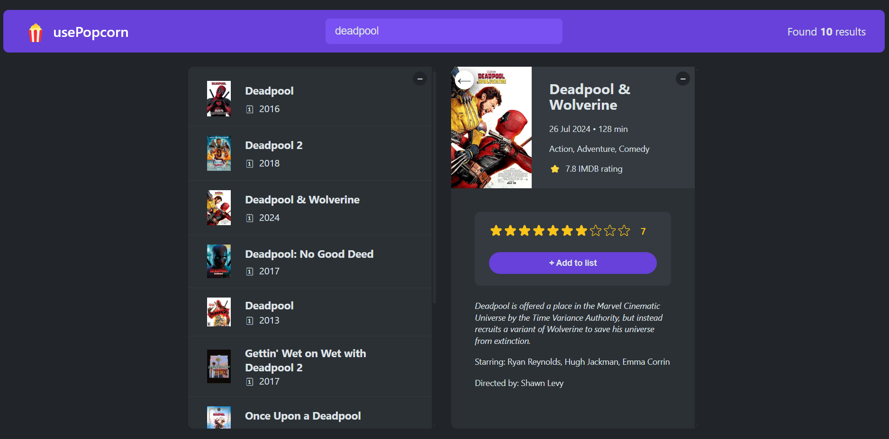

# UsePopCorn



A React learning application for searching movies and saving watch ratings in local storage. It practices effects, custom hooks, and browser persistence.

Learning project built while following [The Ultimate React Course](https://www.udemy.com/course/the-ultimate-react-course/) by Jonas Schmedtmann. The application concept and course design come from the course; this repository contains my course implementation. It is retained as learning work.

## Live Demo

[Hosted demo (availability not verified)](https://usepopcorn-abdousadik.netlify.app/).

---

## Table of Contents

- [Description](#description)
- [Technologies](#technologies)
- [Getting Started](#getting-started)
- [References](#references)

---

## Description

This course implementation lets you:

- Use a search bar to look up movies from a comprehensive API.
- Rate your favorite or recently watched movies.
- Store and manage your ratings using local storage, ensuring they are saved even after closing the browser.

---

## Technologies

This project was built using:

- **React**

---

## Getting Started

To get started with the UsePopCorn project, follow these steps:

1. Clone the repository:

   ```bash
   git clone https://github.com/abdousadik/usepopcorn-movies.git
   ```

2. Navigate to the project directory:

   ```bash
   cd usepopcorn-movies
   ```

3. Install the necessary dependencies:

   ```bash
   npm ci
   ```

4. Start the development server:

   ```bash
   npm run start
   ```

5. Open your browser and visit:
   ```
   http://localhost:3000
   ```

---

## License

This repository contains course-based learning work. Upstream licensing and attribution are being reviewed; no standalone project license is asserted here.

---

## API configuration

Movie search depends on the external movie API referenced in `src/useMovies.js`. Any API key included in frontend source or a frontend build is visible to visitors. Configure provider restrictions and quotas where supported; use a server-side proxy if a key must be kept secret. Moving a key to frontend environment variables alone does not hide it.

## References

[The Ultimate React Course — Jonas Schmedtmann](https://www.udemy.com/course/the-ultimate-react-course/)
